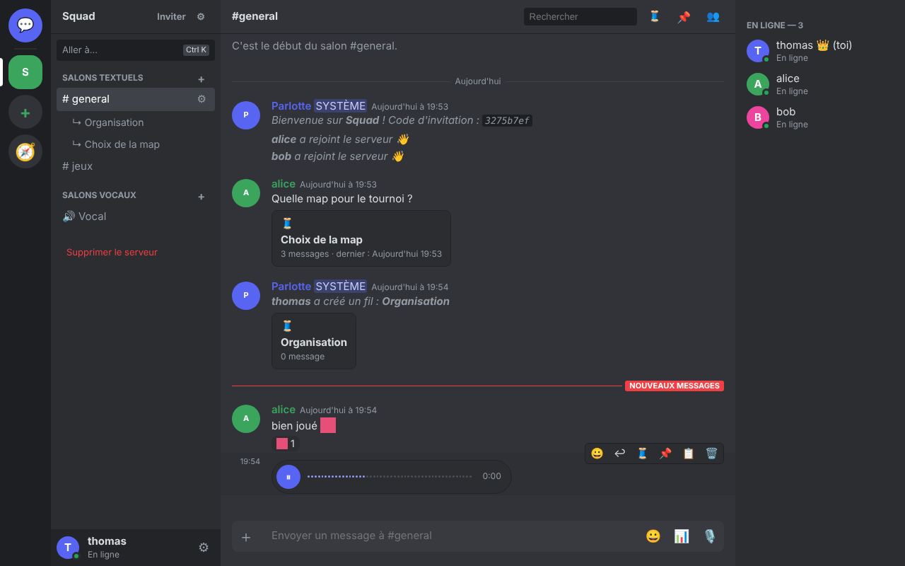
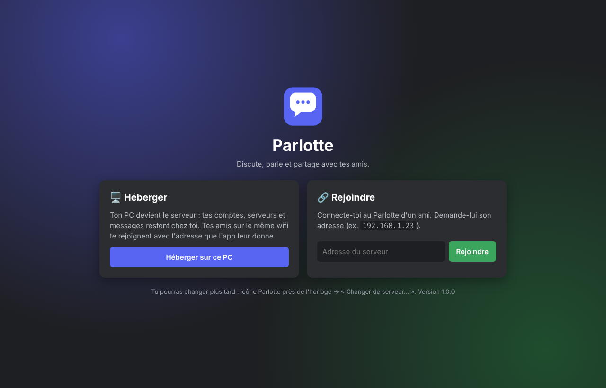
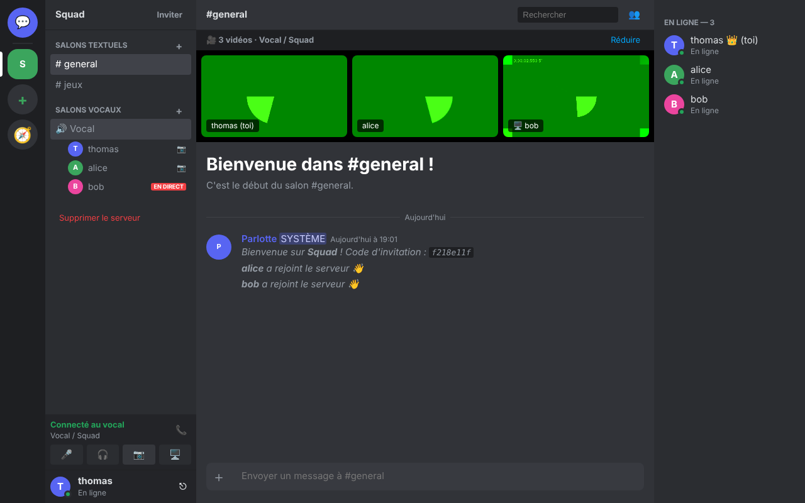
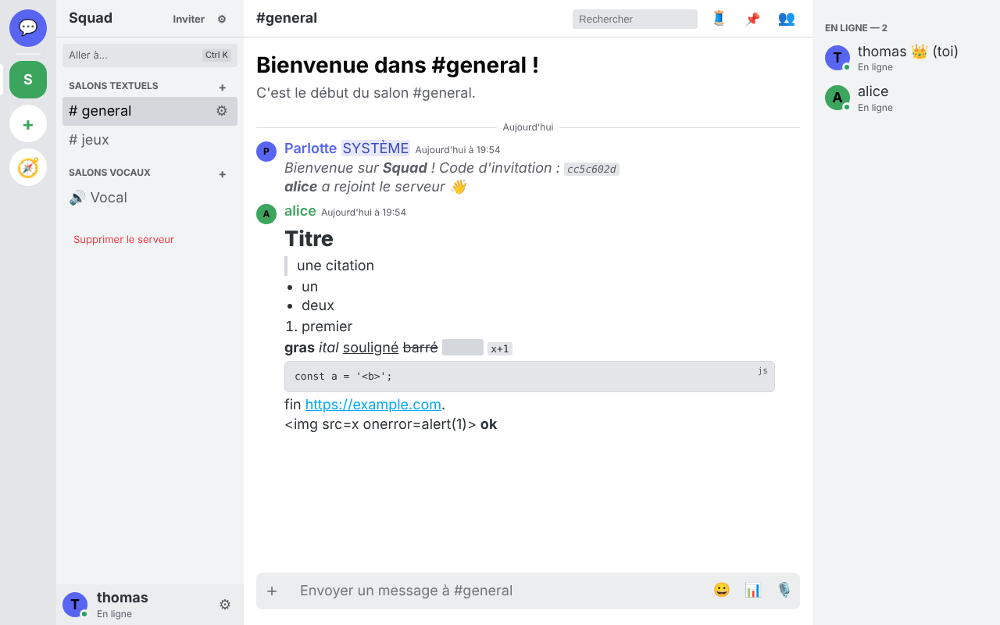

<p align="center"></p>
<h1 align="center">Parlotte</h1>
<p align="center">Discute, parle et partage avec tes amis : salons, messages privés, vocal, vidéo et partage d'écran.<br>
Tout tourne chez vous : un PC héberge, les autres le rejoignent.</p>

<p align="center"></p>

## 📥 Télécharger (Windows)

1. Va dans **[Releases](../../releases/latest)** et télécharge **`Parlotte-Windows.zip`**.
2. Fais clic droit sur le zip → **Extraire tout…**, puis ouvre le dossier `Parlotte`.
3. Lance **`Parlotte.exe`**.
   Windows peut afficher « Windows a protégé votre ordinateur » (l'app n'est pas signée) :
   clique sur **Informations complémentaires** → **Exécuter quand même**.

> Pas de Windows ? Ouvre simplement l'adresse de l'hébergeur dans ton navigateur (même sur téléphone),
> puis ajoute-la à l'écran d'accueil pour l'avoir comme une app.

## 🚀 Utilisation



**Un seul PC héberge** (de préférence celui qui reste allumé) :
- Clique sur **Héberger sur ce PC**.
- Si Windows demande l'accès au réseau, coche **Réseaux privés**.
- Clic droit sur l'icône Parlotte près de l'horloge → **Adresses pour tes amis** → copie l'adresse.

**Les amis rejoignent** :
- Clique sur **Rejoindre** et colle l'adresse de l'hébergeur (ex. `192.168.1.23`).
- La première fois, l'app montre l'empreinte du certificat de l'hébergeur : clique sur **Faire confiance**.
- Crée ton compte, ajoute tes amis, rejoins un serveur avec son code d'invitation.

Il faut être **sur le même wifi**. Les wifi d'école ou publics bloquent souvent les appareils
entre eux : utilise un partage de connexion ou le wifi de la maison.

<br clear="right">

## ✨ Fonctionnalités

| | |
|---|---|
| 💬 **Discussion** | serveurs, salons, fils de discussion, messages privés, réponses, réactions, épinglés, mentions `@`, `@everyone` |
| 🎙️ **Vocal & vidéo** | salons vocaux, appels privés, caméra, partage d'écran, messages vocaux |
| 🎵 **Vocal+** | soundboard (8 sons intégrés + sons perso par serveur), appuyer pour parler, sensibilité du micro, suppression du bruit, choix du micro et de la sortie, volume par personne |
| 🟢 **Statuts** | en ligne, absent (automatique après inactivité), ne pas déranger, invisible, statut perso avec emoji et durée, « 🎮 Joue à … » détecté par l'app |
| 📎 **Partage** | images, vidéos, fichiers (10 Mo), glisser-déposer, coller une image |
| 🛡️ **Modération** | rôles, permissions, salons privés ou en lecture seule, expulser, bannir, bloquer |
| 🎨 **Confort** | thème clair/sombre, emojis perso, sondages, mise en forme (`**gras**`, `||spoiler||`, blocs de code…), Ctrl+K, recherche avec filtres (`from:`, `has:`…) |

<p> </p>

## ⬆️ Mises à jour

À partir de la 1.1.0, l'app vérifie toute seule s'il existe une nouvelle version sur GitHub et propose de l'installer
(bandeau vert, ou icône près de l'horloge → « Installer la mise à jour »). Tes comptes et messages ne bougent pas.

> Bloqué sur un serveur éteint ? <kbd>Ctrl</kbd>+<kbd>Maj</kbd>+<kbd>L</kbd> ramène à l'écran d'accueil.

## 🔒 Vie privée

- Tout est stocké **sur le PC de l'hébergeur** (`%APPDATA%\Parlotte\serveur`) : aucun service externe.
- Les mots de passe sont chiffrés (scrypt). Les connexions passent en HTTPS avec un certificat créé
  par l'hébergeur ; l'app retient son empreinte et prévient si elle change.
- Le vocal et la vidéo passent directement d'un appareil à l'autre (WebRTC).
- Le « jeu en cours » se base sur la liste des programmes lancés, reste sur ton PC et se désactive dans Paramètres → Statut.
- Prévu pour un **réseau local entre amis**, pas pour être exposé sur Internet.

## 🛠️ Pour les développeurs

```
server/     serveur Node.js sans dépendance (HTTP/HTTPS, WebSocket, stockage JSON) + app web (public/)
desktop/    application de bureau Electron (héberger / rejoindre, intégrations Windows)
```

- Serveur seul : `node server/server.js` (ou `lancer-serveur.bat`), puis `http://localhost:3000`.
- App de bureau : `cd desktop && npm install && npm start`.
- Construire pour Windows : `cd desktop && npm run build:win` → `desktop/dist/win-unpacked/` (à zipper).

Licence MIT.
